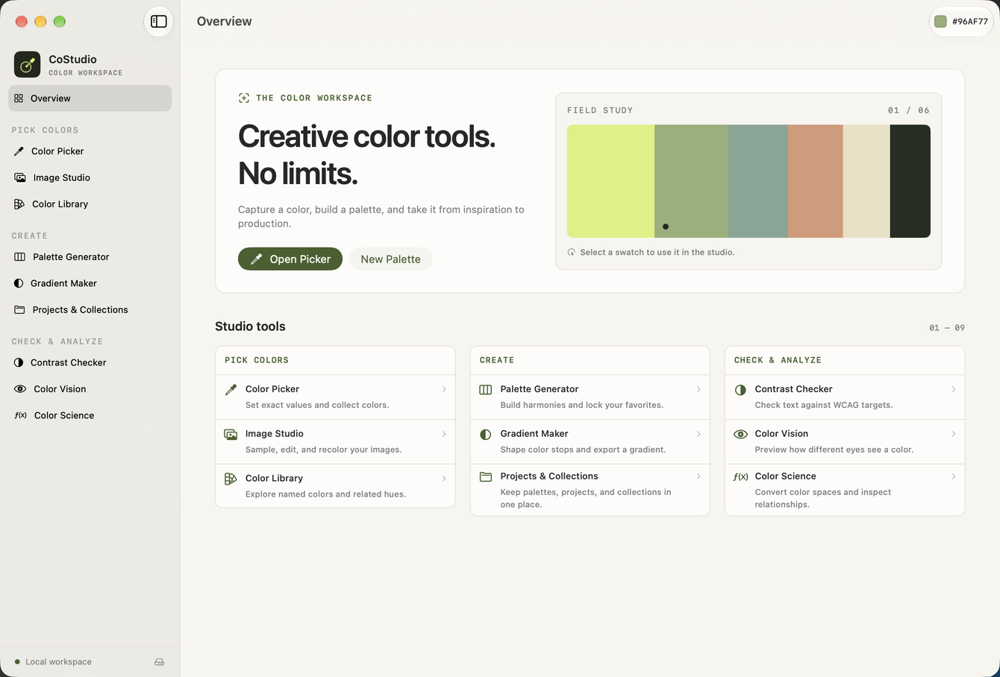
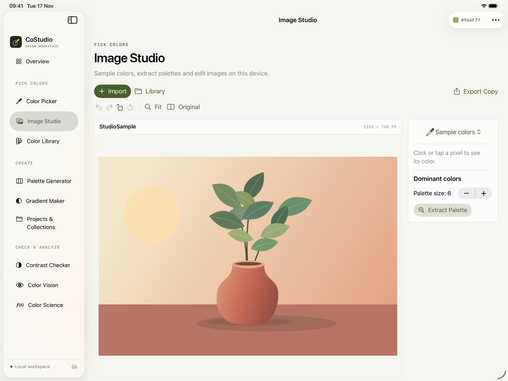

<div align="center">
  
  <h1>CoStudio</h1>
  <p><strong>Creative color tools. No limits.</strong></p>
  <p>A free, open-source color and image studio for Mac and iPad.</p>
</div>

CoStudio brings color sampling, palette design, contrast checking, and image
editing into one native workspace. Work offline and take the result into your
design tool, codebase, or local library.

## Screenshots

| macOS · Overview | iPadOS Simulator · Image Studio |
| --- | --- |
| [](docs/screenshots/macos-overview.png) | [](docs/screenshots/ipados-image-studio.png) |

[Color Picker in light appearance](docs/screenshots/macos-picker.png) ·
[Palette Generator in dark appearance](docs/screenshots/macos-palette-dark.png)

## Studio tools

| Workspace | What you can do |
| --- | --- |
| Pick colors | Pick in HEX, RGB, HSL, and HSV; adjust opacity; copy, revisit, and favorite colors; browse 148 named CSS colors. |
| Create | Generate palettes with color harmonies and locked swatches; edit linear and radial gradients; organize work into local projects and collections. |
| Check | Compare foreground and background against WCAG AA and AAA targets; inspect color-vision simulations side by side. |
| Analyze | Convert between ten color formats, make variations, and copy snippets for CSS, Swift, Tailwind, or design tokens. |
| Edit images | Sample pixels and extract palettes; crop and rotate; replace colors or apply palette effects; use on-device subject masking when supported. |
| Export | Save palettes as HEX, JSON, CSS, SCSS, tokens, SVG, ASE, or ACO; gradients as CSS or SVG; edited images as PNG, JPEG, or TIFF. |

Read the [studio guide](docs/STUDIO_GUIDE.md) for workflows, format details,
and current limitations.

## Compatibility and installation

The deployment targets are **macOS 14** and **iPadOS 17** or later. Build from
source with Xcode 16.4 or newer. Add an iPad simulator runtime in Xcode if you
intend to use Simulator. Installing on a physical iPad requires a development
team or distribution signing.

1. Download the source or clone the repository.
2. Open `CoStudio.xcodeproj` and select the **CoStudio** scheme.
3. Select **My Mac** or an iPad simulator and choose **Product → Run**.

```sh
open CoStudio.xcodeproj
xcodebuild -project CoStudio.xcodeproj -scheme CoStudio -destination 'platform=macOS' build
```

SwiftUI provides the native interface; SwiftData stores the library. Image
work uses Core Graphics, Image I/O, Core Image, and Vision. XCTest covers the
domain code and key workspace interactions. There are no third-party runtime
dependencies.

## Privacy

The studio has no accounts, analytics, advertising, or server-side image
processing. Projects, palettes, preferences, and studio copies of imported
images live on the device. Explicit exports and backups go to the location
you select. See [Privacy](PRIVACY.md).

## Project

- [Development](docs/DEVELOPMENT.md) · [Local verification](docs/VERIFICATION.md)
- [Dependencies and licenses](docs/DEPENDENCIES.md)
- [Contributing](CONTRIBUTING.md) · [Code of conduct](CODE_OF_CONDUCT.md) · [Security](SECURITY.md)
- [Changelog](CHANGELOG.md) · [Release checklist](docs/RELEASE.md)

Potential follow-up work includes a vetted on-device super-resolution model,
broader color management and export validation, and expanded testing on
physical iPads and older platform versions.

CoStudio is available under the [MIT license](LICENSE).
